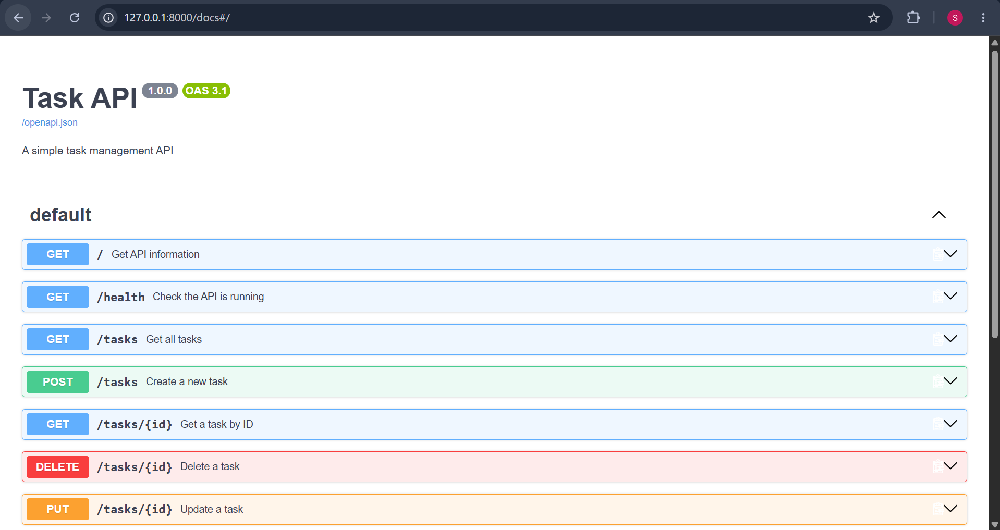
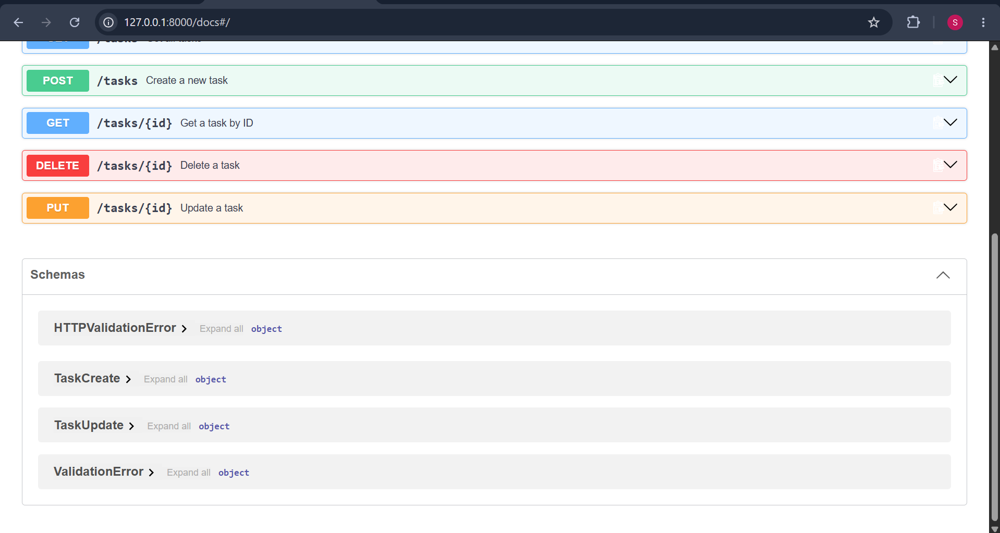
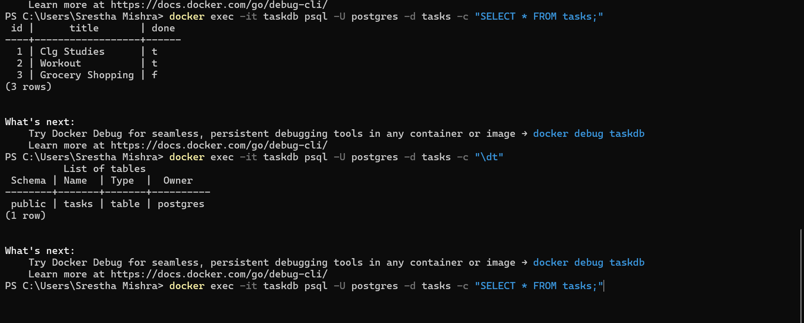

# Task API
I have built a task api which uses CRUD steps for a to do list a simple to do list which add uodate remove and take confirmation for task completion using boolean 

## Setup

```
git clone https://github.com/sres-092/Task-API.git
cd task-api
python -m venv venv
venv\Scripts\Activate.ps1 # Windows
source venv/bin/activate # Mac/Linux
pip install -r requirements.txt
fastapi dev main.py
```

Runs at http://127.0.0.1:8000 — interactive docs at /docs

## Endpoints

| Method | Path | Description |
|--------|------|-------------|
| GET | / | Get API information |
| GET | /health | Check the API is running |
| GET | /tasks | Get all tasks |
| GET | /tasks/{id} | Get a task by ID |
| POST | /tasks | Create a new task |
| PUT | /tasks/{id} | Update a task |
| DELETE | /tasks/{id} | Delete a task |
 
## Swagger UI

 


## Example request

```
curl.exe -i -X POST http://127.0.0.1:8000/tasks -H "Content-Type: application/json" -d '{\"title\": \"Buy bread\"}'

HTTP/1.1 201 Created
date: Fri, 18 Sep 2026 08:55:09 GMT
server: uvicorn
content-length: 41
content-type: application/json

{"id":5,"title":"Buy bread","done":false}
```

## Running it

You need Docker Desktop installed. Nothing else — no Python, no Postgres.

```
git clone https://github.com/sres-092/Task-API.git
cd Task-API
copy .env.example .env
docker compose up
```

That starts the API and a Postgres database together. The API is at
http://localhost:8000, docs at http://localhost:8000/docs.

The table is created automatically on first run and seeded with three
example tasks.

## Configuration

The database connection string comes from a `.env` file, which is
git-ignored so no password is ever committed. `.env.example` is
committed with the same keys and placeholder values — copy it to
`.env` before starting.

When running through Docker Compose, the app reaches the database at
the service name `db`, not `localhost`.

## What changed from A2

Storage moved from a SQLite file to Postgres running in a container.
Every endpoint kept its path, its request shape, its response shape
and its status codes — nothing a client sees changed.

Being honest about the layering: my database code lives inside the
route functions rather than in a separate repository module, so the
swap touched more lines than it ideally would. The queries changed
(`?` placeholders became `%s`, `INTEGER PRIMARY KEY` became `SERIAL`,
inserts now use `RETURNING *` instead of `lastrowid`) but the logic
around them did not. A15 formalizes pulling that into its own layer.

## Persistence

Data survives a full stack restart because the Postgres container
mounts a named Docker volume.

How I checked: created a task through `POST /tasks`, ran
`docker compose down` to destroy both containers, then
`docker compose up -d` to recreate them. `GET /tasks` still returned
the task — the containers were new, the volume was not.

## Data in the database

`\dt` lists the tasks table and a `SELECT` shows the seeded rows,
queried directly inside the Postgres container:


